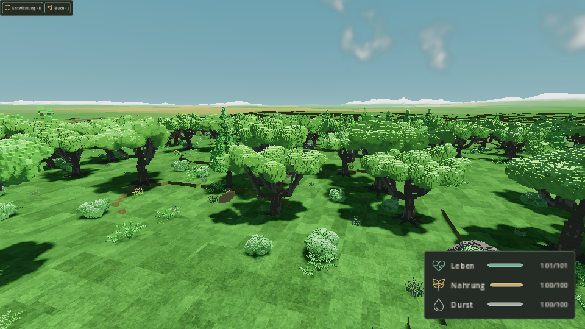
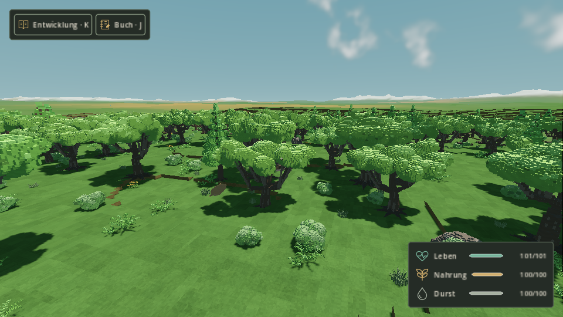
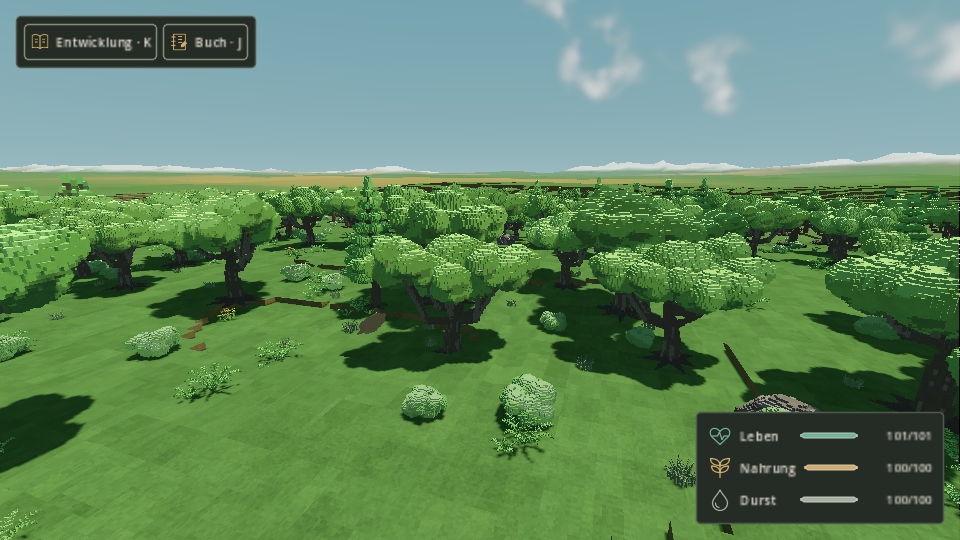

# GFX-REF-01 · Naturgrafik · 22.10.2026

Produktlieferung: [PR #289](https://github.com/MajorDragonfly/voxelverse/pull/289).
Feste Basis `0b442797f1170fc55d0084380bd9d2f27cf7912f`, Produktkopf
`e1e3c5e1a5058ebd05a9c48ba40e62b22af2cbd7`, Tree
`fce1f0510947857b4f42b2cdbed0a0a436cd14f1`.
Dieser Nachweisbranch ergänzt ausschließlich die Belege. Er wird nicht als Produktmerge verwendet.

## Technischer Abschluss

PR #289 ist nach main übernommen. Tatsächlicher Main-Merge `64c3ac6bd9797006c5f269f6fb8fa2c7b50d0508`,
Tree `fce1f0510947857b4f42b2cdbed0a0a436cd14f1`, identisch zum vollständig geprüften CI-Tree.
298/298 eindeutige Quelltests tatsächlich ausgeführt, Runtime 27/27,
Linux und Windows jeweils 42/42 Exportkontrollen und drei positive PCK-Planetenproben.
Alle 30 PR-Prüfungen und vier aktuelle Pflichtgates (App 15368) positiv.
[Ausführungsbeleg der acht Quelltestteile](ci-source-execution.json) ·
[Merge, Gates, Paketchecksummen und Plattformbelege](ci-acceptance.json).
Die beiden Exportdiagnose-ZIPs liegen unverändert bei. Windows wird mit seinem
eigenen, vor und nach den Prüfungen unveränderten Quellenfingerprint geführt,
bei identischem sauberem Git-Tree. Die folgenden Erstbelege bleiben datiert erhalten.

## Sichtbare Änderung

Die große Eiche erhält eine verbundene, tiefere Krone statt isolierter Laubschalen.
Die breite Wuchsform bekommt mehr Kronenhöhe. Bereits belegte Blattzellen erhalten
jetzt ihre helleren und dunkleren Pigmente, ohne das Holz oder die belegte Form zu
übermalen. Der gemeinsame Nah-/Fernshader ergänzt gefilterte Struktur für Rinde,
Laub und Gestein. Die Modellierung bleibt original und parametrisch.

27 GLBs und neun editierbare Blockbench-Quellen wurden für Eiche, Kiefer und Busch
mit je drei Wuchsformen und drei LODs erzeugt. Die neun Nahmodelle zusammen haben
101966 → 93630 Dreiecke (−8,18 %), Mid 19574 → 21336 (+9,00 %), Far 5276 → 6016
(+14,03 %). Details: [Geometrievergleich](geometry-comparison.json).
Das Qualitätsniveau der drei Nutzerreferenzen ist damit noch nicht vollständig erreicht.

## Tatsächliche Spielbilder

Unveränderte Original-PNGs der öffentlichen Kugelkampagne, gleicher portabler Save,
Körper, Palette, Grafikwerte, Kamera und Tageszeit innerhalb jedes Vergleichspaars.

| Renderer | Vorher | Nachher |
|---|---|---|
| Compatibility |  |  |
| Forward+ |  |  |

Alle vier Hauptläufe sind positiv und enthalten je sechs Originalbilder:
Wald, Ufer und Nahaufnahme bei Tag und Nacht. Der strenge Paarvergleich ist nach
der unten dokumentierten Nahaufnahme-Korrektur für zwölf Paare positiv.
[Maschinenbericht](native-comparison.json) · [Vergleicher](compare_graphics.py).

Die erste GL-Nahaufnahme war für einen strengen Bildvergleich nicht geeignet:
Der bestehende Prüfer ergänzt eine fehlende Nahansicht aus der Spielerposition
nach dem Laden. Die Startphysik lieferte dabei 0,038150016 m Höhenunterschied,
obwohl die gedruckten lokalen Kameramatrizen gleich waren. Der ursprüngliche
negative Vergleich bleibt in `native-comparison-initial.json` und den Originalen.
Die zwei betroffenen Ansichten wurden separat mit der vorhandenen expliziten
kanonischen Nahansicht aus demselben portablen Referenzsnapshot wiederholt.
Der Vergleicher prüft bei dieser Wiederholung dieselben Gleichheitsbedingungen.
Spielcode, ursprünglicher Prüfer, Deadlines und numerische Grenzen wurden nicht geändert.

Beim zusätzlichen Nahansichtspaar unterscheiden sich ausschließlich im sonst
identischen Körperdatensatz die Richtung und Warteliste der inkrementellen
Haustier-Standortsuche (`fauna_catalog.surface_search`, Richtung 4/3, fünf/vier
Suchknoten). Das ist ein während des öffentlichen Ladens weiterlaufender
Suchcursor, keine Spezies- oder sichtbare Platzierungsänderung. Der erste strenge
Gesamt-Dictionaryvergleich bleibt als `native-comparison-fixed-position-negative.json`
erhalten. Der finale Bildvergleich führt dieses Feld samt vollständigen Werten
ausdrücklich unter `nonvisual_differences` und verlangt für sämtliche übrigen
Körperfelder weiterhin Gleichheit. Kamera, Palette, Licht und Speziesdaten
erhalten keine Toleranz oder Ausnahme.

## Ausgeführte Prüfung

Godot 4.6.3, Linux-Host `fa9fa0aa2a99`, Mesa 25.2.8 / LLVM 20.1.2 / llvmpipe,
vier Software-Threads. Alle Engine-Abschnitte liefen seriell mit beiden vorhandenen
Heavy-Locks; `outer-host-runner.py` dokumentiert den äußeren Lockbesitz.

- Fünf gezielte Godot-Tests mit Import und Quellintegrität positiv: Assetpipeline,
  Produktionsanschluss, Far-Cluster, Scenery-Kollision und Wind-/Arbeitsvisuals.
  Geprüfter lokaler Codecommit `bd8d42036d4f52be862f6e45a297c73860c7d36f`
  hat exakt den veröffentlichten Produkt-Tree.
- Zwei neue Python-Regressionen positiv. Gegen den ursprünglichen Autorenstand
  reproduzieren beide Blattfamilien den Pigmentfehler, der Determinismuskontrollfall bleibt positiv.
- Alle 15 registrierten Near-Quellen bytegleich rückexportiert. Zwölf tatsächliche
  Mid-/Far-Baumexports reproduziert und verbunden; sieben ursprüngliche
  Unterabtastungsfehler werden vom bestehenden Negativkontrollpfad erkannt.
- Native Wind-/Rebase-/Nah-Fern-Materialprüfung in Compatibility und Forward+
  positiv, einschließlich historischer Negativkontrolle. Pausen- und Handoff-
  Differenz jeweils 0, Rebase-Mittelabweichung 9,58e−8 / 1,83e−6.
- Vier Haupt- und zwei zusätzliche Nahansichtsläufe positiv, 28 Originalbilder.
  Der finale Paarvergleich verwendet zwölf positive, identische Aufnahmebedingungen.
  Die beiden ursprünglichen versetzten GL-Nahbilder bleiben erhalten.
- GitHub-Laufzeitabnahme des gemeinsamen Trees positiv: 27 tatsächliche Kontrollen,
  Quellfingerprint `159d3d818dda2f038ed97ff14f9de6389cc4cf8b5139325bfa4d5426a9874613`.
  Original-ZIP und der vollständige 298-Tests-Plan liegen bei. Der Plan ist kein
  Ausführungsnachweis der vollständigen Suite.

Der erste lokale Fokuslauf wurde wegen einer währenddessen neu hinzugefügten
Prüfdatei korrekt als nicht wiederverwendbar verworfen. `focused-checks.zip`
enthält diesen Lauf und den anschließenden vollständig positiven Lauf auf dem
sauberen Produkt-Tree. Daraus wird kein Spielfehler oder nachträglicher Erfolg abgeleitet.

## Kosten und offene Abnahme

Sechs zurückbehaltene pausierte `force_draw`-Messungen pro Ansicht, vier Aufwärm-
Draws, ohne Bild-Readback. Millisekunden sind Software-Renderdiagnosen und keine
Spiel-FPS oder Ziel-PC-Freigabe. Einige Ansichten kosten mehr Renderzeit trotz
geringerer Nahgeometrie. Der Mehrbedarf der Ferngeometrie und Materialien bleibt
Teil der Ziel-PC-Abnahme.

| Renderer | Ansicht | Vorher Median ms | Nachher Median ms | Änderung |
|---|---|---:|---:|---:|
| gl | forest-day | 2908.2 | 3706.5 | +27.5 % |
| gl | forest-night | 2370.6 | 2405.4 | +1.5 % |
| gl | water-day | 1387.7 | 1733.0 | +24.9 % |
| gl | water-night | 1403.6 | 1365.5 | -2.7 % |
| forward | forest-day | 2648.5 | 3516.9 | +32.8 % |
| forward | forest-night | 2632.1 | 3038.9 | +15.5 % |
| forward | water-day | 1532.2 | 1691.1 | +10.4 % |
| forward | water-night | 1491.0 | 1676.7 | +12.4 % |
| forward | creature-close-day | 1092.0 | 1076.8 | -1.4 % |
| forward | creature-close-night | 1026.6 | 1015.1 | -1.1 % |
| gl | creature-close-day | 1044.0 | 922.9 | -11.6 % |
| gl | creature-close-night | 904.1 | 743.4 | -17.8 % |

Vollständige Suite, Desktop-Exporte und vier aktuelle Pflichtgates werden im
Produkt-PR auf dessen unverändertem Tree abgewickelt. Aktueller Prüfstatus:
[Godot](https://github.com/MajorDragonfly/voxelverse/actions/runs/39772332356),
[Desktop](https://github.com/MajorDragonfly/voxelverse/actions/runs/39772332350),
[Rendering](https://github.com/MajorDragonfly/voxelverse/actions/runs/39772332322),
[Dashboard](https://github.com/MajorDragonfly/voxelverse/actions/runs/39772332235).
Diese datierten Teilbelege ersetzen die noch fehlenden aktuellen Gates nicht.
Ziel-PC, Langzeit-FPS und Lars' Spielkomfort bleiben separat.

## Originale und Wiederholung

Die ZIPs enthalten die unveränderten Original-PNGs, Rezepte, Logs, Quellinventare
und Berichte der jeweiligen Läufe. Hashes stehen in `archives.json` und
`product-files.json`. Nach dem Entpacken der Kampagnen-/Nahansicht-ZIPs in einen
gemeinsamen Ordner: `python3 compare_graphics.py --checks ORDNER --fixed-gl-close`.
Die Bilder werden ausschließlich aus Godot gelesen, ohne generative Nachbearbeitung.
